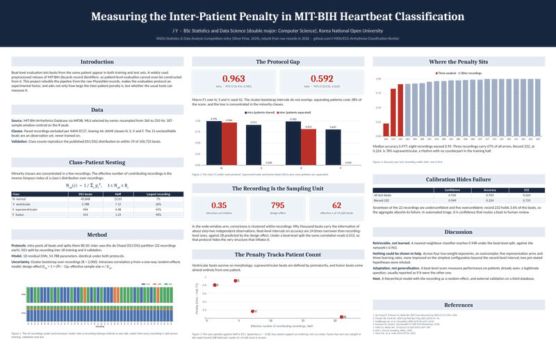
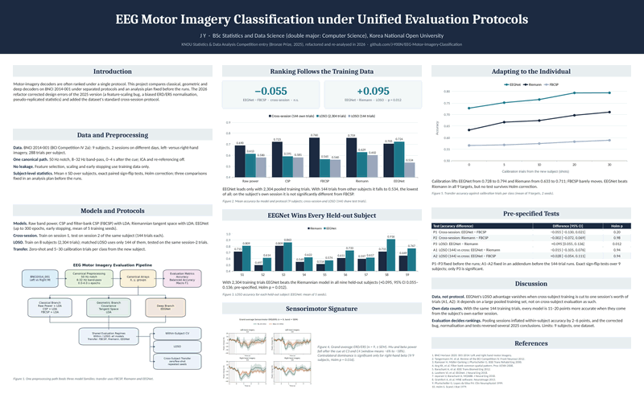
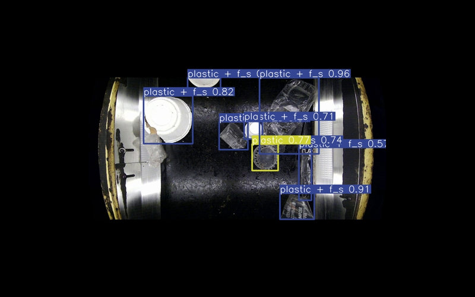

<!--
Internal editing note:
- This README is the GitHub profile page. Keep it short: background, CV and notes belong on the website.
- Project summaries follow each repository's README and report. When a report changes, update the numbers here too.
- The ECG, EEG and Waste Sorting images in assets/ are copies of the website's card thumbnails
  (j-y00n.github.io, assets/images/research/). Copy them again when they change there.
- picture-diary-styles.png is made for this page from two demo images of Multimodal-Picture-Diary
  (assets/demo/output/demo_img2img_monet.png and demo_text2img_animate_landscape.png):
  two equal squares with a transparent gap and no outer margin, so it suits light and dark themes.
- Each thumbnail floats to the right (align="right"). The   that ends each
  link line keeps the next heading below the image, so keep it when editing.
- Do not write the email address in plain text. The website shows it through its Email link.
-->
# J. Yoon

Statistics and machine learning for data that vary across individuals, mainly neural and physiological signals (EEG, ECG).

I came to statistics from clinical practice: five years as a registered nurse, then a BSc in Statistics and Data Science with a double major in Computer Science.
The research projects below both come down to one question: when can a model learned from many people be trusted for the next one?

**[j-y00n.github.io](https://j-y00n.github.io)** · [About](https://j-y00n.github.io/about/) · [Research](https://j-y00n.github.io/research/) · [CV](https://j-y00n.github.io/cv/) · [Notes](https://j-y00n.github.io/notes/)

  
  
  
  
  
  
  

## Research

Two competition entries, rebuilt in 2026.
In both, the answer turned on evaluation and inference rather than on model architecture.
Each repository holds a full report, a one-page poster and the stored run outputs behind its numbers; the earlier version is kept under a git tag.

### [ECG Arrhythmia Classification: Measuring the Inter-Patient Penalty](https://github.com/J-Y00N/ECG-Arrhythmia-Classification-ResNet)

A 1D residual CNN on MIT-BIH, rebuilt from the raw PhysioNet records so that patients can be kept apart between training and test.
Holding out whole patients instead of single heartbeats lowers macro F1 from 0.963 to 0.592.
Beats from one recording are correlated, so about 50,000 test beats carry the information of roughly 60 independent ones, and beat-level confidence intervals come out about 24 times too narrow.

Silver Prize, KNOU Statistics & Data Analysis Competition (2024 entry) · rebuilt 2026

[Code](https://github.com/J-Y00N/ECG-Arrhythmia-Classification-ResNet) · [Report](https://github.com/J-Y00N/ECG-Arrhythmia-Classification-ResNet/blob/main/docs/report.md) · [Poster](https://github.com/J-Y00N/ECG-Arrhythmia-Classification-ResNet/blob/main/docs/poster/ECG_poster.pdf) 

### [EEG Motor Imagery Classification](https://github.com/J-Y00N/EEG-Motor-Imagery-Classification)

Classical (CSP, FBCSP), Riemannian and EEGNet decoders on BNCI 2014-001 under cross-session, leave-one-subject-out and transfer protocols, with the confirmatory comparisons fixed in an analysis plan before the runs.
EEGNet beats the Riemannian decoder for all nine held-out subjects (+9.5 points), but with only one session's worth of training trials from other subjects it falls to near chance: the advantage comes from the large pooled training set, not from cross-subject evaluation as such.

Bronze Prize, KNOU Statistics & Data Analysis Competition (2025 entry) · refactored 2026

[Code](https://github.com/J-Y00N/EEG-Motor-Imagery-Classification) · [Report](https://github.com/J-Y00N/EEG-Motor-Imagery-Classification/blob/main/docs/report.md) · [Analysis plan](https://github.com/J-Y00N/EEG-Motor-Imagery-Classification/blob/main/docs/analysis_plan.md) · [Poster](https://github.com/J-Y00N/EEG-Motor-Imagery-Classification/blob/main/docs/poster/EEG_project_poster.pdf) 

## Applied machine learning

Team projects from Microsoft AI School (2023), refactored in 2026 into standalone Streamlit apps with live demos.

### [Waste Sorting Vision](https://github.com/J-Y00N/Waste-Sorting-Vision)

Household waste detection with YOLOv8, on images and video.
I led the model training: nine recorded runs across class designs, image sizes and dataset sizes, the best reaching mAP@50 0.957 with 8 classes and 38,000 images.
I later rebuilt the code as a modular inference app, which runs a 16-class model by default.

[Code](https://github.com/J-Y00N/Waste-Sorting-Vision) · [Live demo](https://waste-sorting-vision.streamlit.app/) · [Modelling report](https://github.com/J-Y00N/Waste-Sorting-Vision/blob/main/docs/modeling_report.md) 

### [Multimodal Picture Diary](https://github.com/J-Y00N/Multimodal-Picture-Diary)

Turns diary text and an optional reference photo into a stylised picture-diary page with Stable Diffusion 1.5.
I trained the two LoRA style adapters, Monet and anime landscape, and later rebuilt the app around them.
The repository keeps the surviving training configs and logs, and says what could not be recovered.

[Code](https://github.com/J-Y00N/Multimodal-Picture-Diary) · [Live demo](https://multimodal-picture-diary-25vtwte77q6nxwtbdhhpp9.streamlit.app/) · [Monet LoRA](https://huggingface.co/J-YOON/lora-monet-sd1.5) · [Landscape LoRA](https://huggingface.co/J-YOON/animate-lora-sd1.5) 

## Elsewhere

- Website: [j-y00n.github.io](https://j-y00n.github.io) for background, CV and notes ([source](https://github.com/J-Y00N/j-y00n.github.io))
- Hugging Face: [J-YOON](https://huggingface.co/J-YOON) for the LoRA adapters
- Contact: by email, through the link on the website
